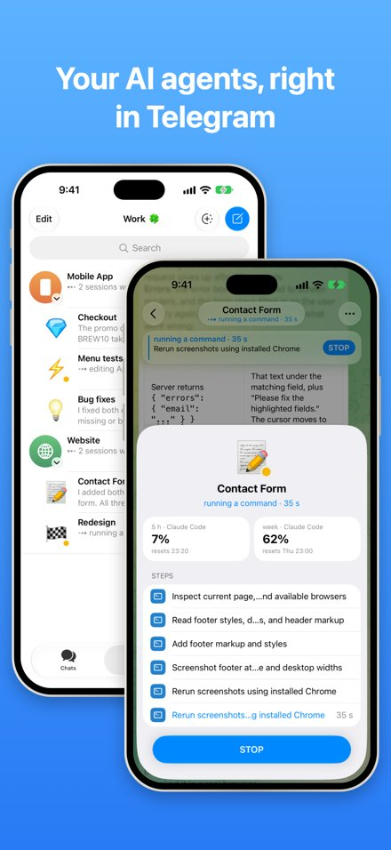
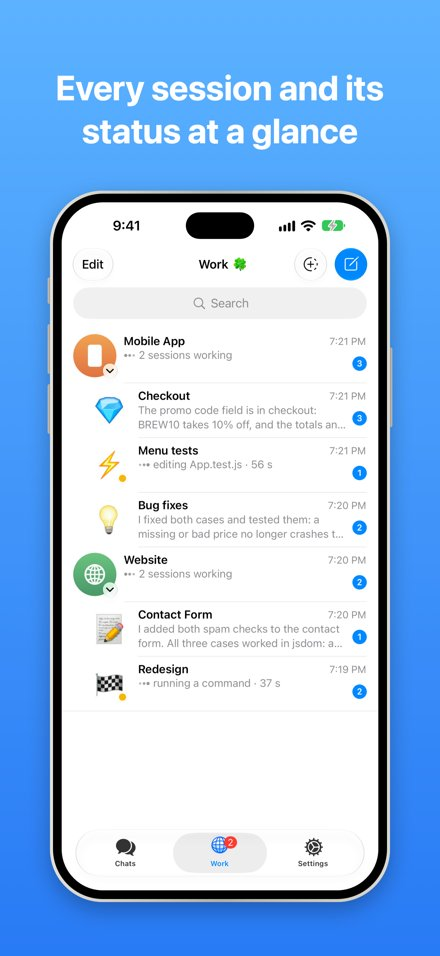
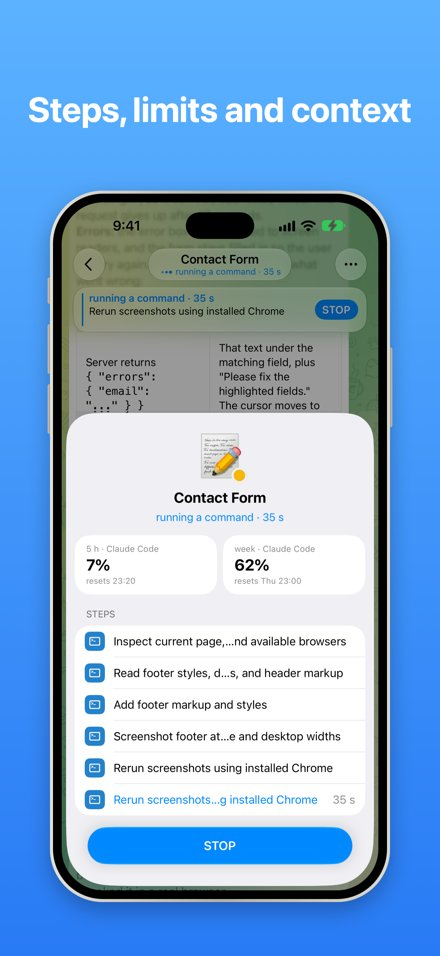
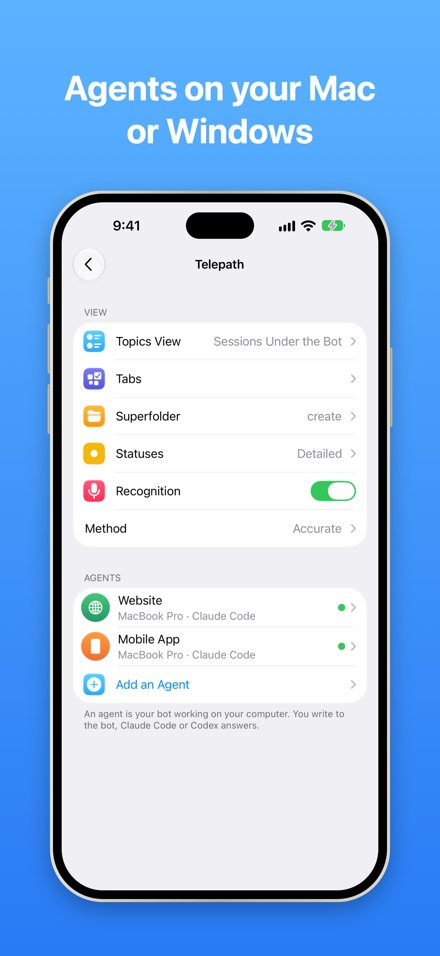
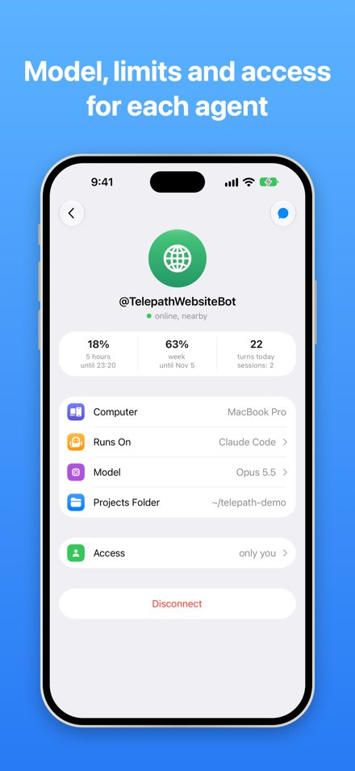
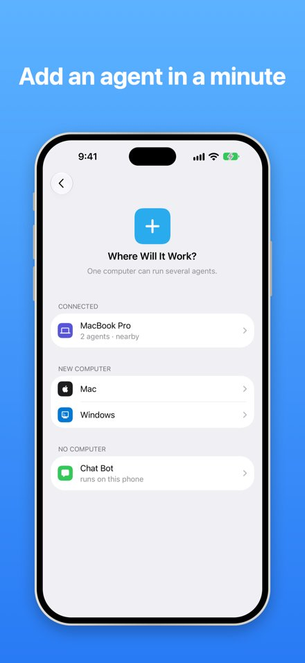

<h1 align="center">Telepath</h1>

Telegram for people who work with AI agents.

Telepath is a Telegram client for iPhone, built on the open source [Telegram for iOS](https://github.com/TelegramMessenger/Telegram-iOS). It works with your own Telegram account and adds what you need to work with AI agents.

An agent in Telepath is your own Telegram bot. It can:

- **work on your computer.** Telepath Helper, a small free app for Mac and Windows, runs Claude Code or Codex in your project folder. You write to the bot, the agent does the work on your computer and answers in the chat.
- **be a simple chat bot.** It answers with a model from OpenRouter, right from your phone, with your own key. No computer needed.

## What you get

- **See what the agent is doing.** Reading files, running commands, editing code: the current step is right in the chat, and the whole list of steps is one tap away.
- **Stop it with one tap.**
- **Sessions under the bot.** Each topic of the bot is a session, listed under the bot in the chat list with its status.
- **Limits and context.** How much of the 5 hour and weekly limits is used, and how full the session's context is.
- **Voice messages** turned into text on your computer.
- **Tabs and a superfolder** to keep your agents together.

## Get it

- **iPhone:** Telepath in the App Store (coming soon).
- **Telepath Helper** for Mac and Windows: [Releases](https://github.com/olegaego/telepath/releases/latest).

## Telepath Helper

A small app for your computer that runs your agents. You write to your bot in Telepath, the agent works in your project folder on this computer and answers in the chat. It lives as an icon in the menu bar on a Mac and by the clock on Windows, with no window.

**What you need:** Telepath on your iPhone; Claude Code or Codex installed on the computer and signed in; a Telegram bot for each agent, made in [BotFather](https://t.me/BotFather) (/newbot). For sessions as topics, turn on Threaded Mode for the bot in BotFather.

**Install:** on a Mac open `Telepath-Helper.dmg` and drag Telepath Helper to Applications (it is notarized by Apple); on Windows unpack `Telepath-Helper-Windows.zip` and run `Telepath Helper.exe`.

**Connect:** with the phone and the computer on the same Wi-Fi, open Settings → Telepath → Add an Agent in Telepath, pick the computer, check that both show the same code, paste the bot's token and pick the engine. You connect once; after that the agent answers from anywhere while the computer is on.

- Several agents on one computer, each with its own bot, engine and projects folder.
- Voice messages turned into text on the computer (Whisper), or by Groq with your own key.
- The bot's token stays on the computer: it comes from the phone directly, encrypted, over your Wi-Fi.
- The helper updates itself from [Releases](https://github.com/olegaego/telepath/releases).

## Privacy

- Your messages, contacts and account go between your phone and Telegram, as in Telegram's own app. We run no servers that receive them.
- No analytics, no ads, no tracking.
- Bot tokens and keys stay on your own phone and computer. A bot's token goes from the phone to your computer directly, encrypted, over your Wi-Fi.

The full policy: [olegaego.com/telepath/privacy](https://olegaego.com/telepath/privacy).

## Code

- `submodules/Agentgram*`, `submodules/TelegramUI/Sources/Agentgram*`: Telepath's own screens and logic. Changes inside Telegram's files are marked `// Agentgram`.
- `helper/`: Telepath Helper (Go).
- `push-relay/`: the notification relay.

Building the app: [docs/building.md](docs/building.md) (Telegram's guide; use your own `api_id`). Building Telepath Helper: `cd helper && ./build-mac.sh` or `./build-windows.sh`.

## License

GPL v2, like Telegram for iOS. See [LICENSE](LICENSE).

Telepath is not affiliated with Telegram.

Support: [telepath@olegaego.com](mailto:telepath@olegaego.com) · News: [@gotelepath](https://t.me/gotelepath)
